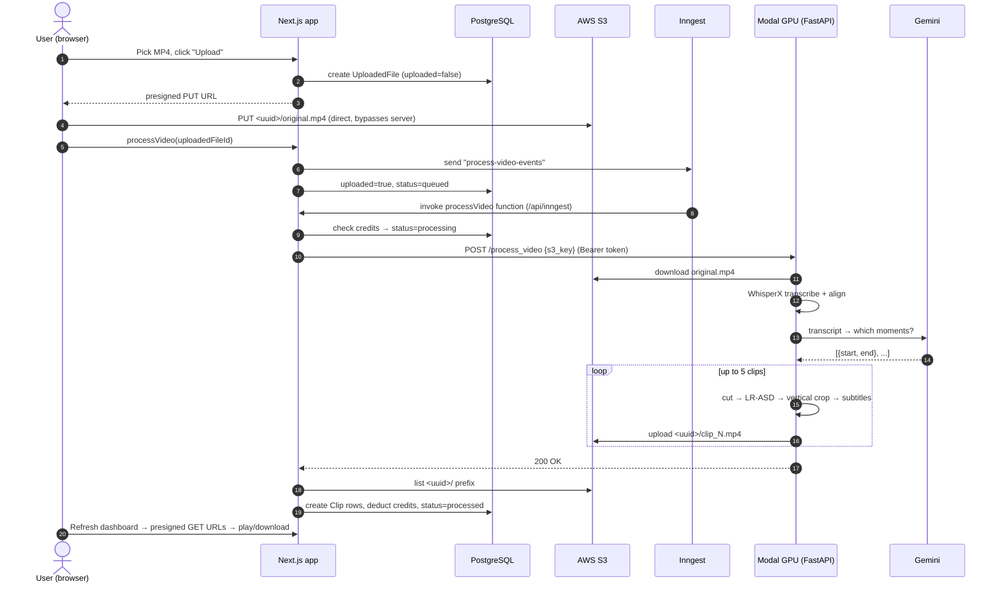

# 🎙️ AI Podcast Clipper

**Turn a full-length podcast into vertical, subtitled, speaker-tracked short clips for TikTok, YouTube Shorts, and Reels.**

---

## Table of contents

- [Features](#features)
- [How it works](#how-it-works)
- [Tech stack](#tech-stack)
- [Project structure](#project-structure)
- [Prerequisites](#prerequisites)
- [Setup](#setup)
  - [1. Clone](#1-clone)
  - [2. Database](#2-database-postgresql)
  - [3. AWS S3](#3-aws-s3)
  - [4. Gemini API key](#4-gemini-api-key)
  - [5. Modal backend](#5-modal-gpu-backend)
  - [6. Stripe](#6-stripe)
  - [7. Frontend](#7-frontend)
- [Running locally](#running-locally)
- [Environment variables](#environment-variables)
- [Deployment](#deployment)
- [Troubleshooting & gotchas](#troubleshooting--gotchas)
- [Credits](#credits)

---

## Features

| Area | What you get |
|---|---|
| 🧠 Moment detection | Gemini reads the word-level transcript and returns 30–60 s question/answer or story clips |
| 📝 Transcription | [WhisperX](https://github.com/m-bain/whisperX) `large-v2` with word-level timestamp alignment |
| 🎯 Speaker tracking | [LR-ASD](https://github.com/Junhua-Liao/LR-ASD) active-speaker detection decides which face to crop to |
| 📱 Vertical output | 1080×1920 crop that follows the speaker; letterboxed over a blurred background when no one is talking |
| 🔤 Subtitles | Bold "Anton"-font captions, 5 words at a time, burned in with FFmpeg + ASS |
| ⚡ Serverless GPU | Runs on an NVIDIA L40S on [Modal](https://modal.com); scales to zero when idle |
| 📊 Job queue | [Inngest](https://www.inngest.com) runs long jobs durably, one at a time per user, with retries |
| 💳 Payments | Stripe Checkout credit packs (50 / 150 / 500), with credits added via webhook |
| 👤 Auth | Email + password with Auth.js (credentials provider, bcrypt, JWT sessions) |
| 🎨 UI | Next.js 15 App Router, React 19, Tailwind v4, shadcn/ui |

---

## How it works



Billing runs alongside this: **Billing page → Stripe Checkout → `checkout.session.completed` webhook → `/api/webhooks/stripe` → credits incremented.**

---

## Tech stack

**Frontend / API:** Next.js 15 (App Router, Server Actions), React 19, TypeScript, Tailwind CSS v4, shadcn/ui, Auth.js v5, Prisma, Zod, react-hook-form
**Queue:** Inngest
**Storage:** AWS S3 (presigned URLs)
**Payments:** Stripe Checkout + webhooks
**Backend:** Python 3.12, Modal, FastAPI, WhisperX, LR-ASD (PyTorch), OpenCV, ffmpegcv (NVENC), FFmpeg, pysubs2, Google Gen AI SDK
**Database:** PostgreSQL

---

## Project structure

```
ai-podcast-clipper-saas/
├── ai-podcast-clipper-backend/        # Python, deployed to Modal
│   ├── main.py                        # Modal app: GPU class + FastAPI endpoint + video pipeline
│   ├── requirements.txt
│   ├── ytdownload.py                  # Helper: download a YouTube video for testing
│   └── asd/                           # ← clone of LR-ASD (you add this, see setup)
│
└── ai-podcast-clipper-frontend/       # Next.js (create-t3-app base)
    ├── prisma/schema.prisma           # User, UploadedFile, Clip + Auth.js tables
    └── src/
        ├── env.js                     # Type-safe env var validation
        ├── actions/                   # Server Actions (called from the client)
        │   ├── auth.ts                #   signUp → bcrypt + Stripe customer
        │   ├── s3.ts                  #   generateUploadUrl → presigned PUT
        │   ├── generation.ts          #   processVideo (enqueue), getClipPlayUrl
        │   └── stripe.ts              #   createCheckoutSession
        ├── inngest/
        │   ├── client.ts
        │   └── functions.ts           # The durable "process-video" workflow
        ├── app/
        │   ├── login/ signup/         # Auth pages
        │   ├── dashboard/             # Upload, queue status, clips
        │   │   └── billing/           # Credit packs
        │   └── api/
        │       ├── auth/[...nextauth]/
        │       ├── inngest/           # Inngest calls in here
        │       └── webhooks/stripe/   # Stripe calls in here
        ├── components/                # dashboard-client, clip-display, forms, ui/*
        ├── server/auth/               # Auth.js config
        └── server/db.ts               # Prisma singleton
```

---

## Prerequisites

| Tool | Version | Notes |
|---|---|---|
| Node.js | 20+ | |
| Python | **3.12** | Only needed for the Modal CLI locally; the heavy ML deps run in Modal's container |
| PostgreSQL | 14+ | Local install, Docker, or a hosted DB (Neon, Supabase, etc.) |
| [Stripe CLI](https://docs.stripe.com/stripe-cli) | latest | For forwarding webhooks locally |

Accounts (all have free tiers): **AWS**, **Modal**, **Google AI Studio**, **Stripe**. Inngest needs no account for local dev.

---

## Setup

### 1. Clone

```bash
git clone https://github.com/ArnavMandal/PodcastClipper.git
cd PodcastClipper
```

### 2. Database (PostgreSQL)

```bash
createdb ai_podcast_clipper
# DATABASE_URL="postgresql://<you>@localhost:5432/ai_podcast_clipper"
```

The schema is pushed in step 7.

### 3. AWS S3

1. **Create a bucket.** S3 bucket names are globally unique, so you probably can't use `ai-podcast-clipper`.
   > ⚠️ The bucket name is **hard-coded** in `ai-podcast-clipper-backend/main.py` (twice: in `process_clip` → `upload_file` and in `process_video` → `download_file`). Change both to match your bucket.

2. **CORS** (Bucket → Permissions → CORS) lets the browser upload directly:

   ```json
   [
     {
       "AllowedHeaders": ["Content-Type", "Content-Length", "Authorization"],
       "AllowedMethods": ["PUT"],
       "AllowedOrigins": ["*"],
       "ExposeHeaders": ["ETag"],
       "MaxAgeSeconds": 3600
     }
   ]
   ```
   In production, replace `"*"` with your domain.

3. **IAM user.** Create a user with this inline policy, then create an access key for it:

   ```json
   {
     "Version": "2012-10-17",
     "Statement": [
       { "Effect": "Allow", "Action": ["s3:ListBucket"], "Resource": "arn:aws:s3:::YOUR_BUCKET" },
       { "Effect": "Allow", "Action": ["s3:GetObject", "s3:PutObject"], "Resource": "arn:aws:s3:::YOUR_BUCKET/*" }
     ]
   }
   ```

### 4. Gemini API key

Create one at [Google AI Studio](https://aistudio.google.com/apikey).

> ⚠️ `main.py` uses `gemini-2.5-flash-preview-04-17`. Google retires preview model IDs, so if you get a "model not found" error, change it to a current model (e.g. `gemini-2.5-flash`) in `identify_moments()`.

### 5. Modal (GPU backend)

```bash
cd ai-podcast-clipper-backend

# The speaker-detection model must live in ./asd (it's copied into the container image)
git clone https://github.com/Junhua-Liao/LR-ASD.git asd

python3.12 -m venv .venv && source .venv/bin/activate
pip install modal          # that's all you need locally
modal setup                # opens a browser to authenticate
```

Create the secret the app reads (`modal.Secret.from_name("ai-podcast-clipper-secret")`):

```bash
modal secret create ai-podcast-clipper-secret \
  AWS_ACCESS_KEY_ID=... \
  AWS_SECRET_ACCESS_KEY=... \
  AWS_DEFAULT_REGION=us-east-1 \
  GEMINI_API_KEY=... \
  AUTH_TOKEN=$(openssl rand -hex 32)   # remember this, the frontend needs it
```

Deploy:

```bash
modal deploy main.py
```

The first build takes several minutes because it pulls a CUDA image and installs torch and WhisperX. Copy the printed `...process-video.modal.run` URL into `PROCESS_VIDEO_ENDPOINT`.

> `modal run main.py` runs the `main()` local entrypoint, which POSTs a hard-coded test `s3_key` with token `123123`. Edit both before using it.

### 6. Stripe

1. In **test mode**, create three products, each with a **one-time** price:
   | Product | Price | Credits granted |
   |---|---|---|
   | Small Pack | $9.99 | 50 |
   | Medium Pack | $24.99 | 150 |
   | Large Pack | $69.99 | 500 |
2. Copy the three `price_...` IDs into `STRIPE_*_CREDIT_PACK`.
3. Copy the secret and publishable keys from Developers → API keys.
4. For local webhooks:
   ```bash
   stripe login
   stripe listen --forward-to localhost:3000/api/webhooks/stripe
   ```
   Copy the printed `whsec_...` into `STRIPE_WEBHOOK_SECRET`.

### 7. Frontend

```bash
cd ai-podcast-clipper-frontend
npm install                 # .npmrc sets legacy-peer-deps (shadcn-dropzone predates React 19)
cp .env.example .env        # fill it in (see table below)
npx prisma db push          # create tables
```

---

## Running locally

Run each of these in its own terminal:

| # | Directory | Command | Purpose |
|---|---|---|---|
| 1 | `frontend/` | `npm run dev` | Next.js on http://localhost:3000 |
| 2 | `frontend/` | `npm run inngest-dev` | Inngest dev server + dashboard on http://localhost:8288 |
| 3 | anywhere | `stripe listen --forward-to localhost:3000/api/webhooks/stripe` | Forwards payment webhooks |

The backend is already deployed on Modal, so it needs no local process.

**Try it:** sign up at `/signup` (new users get **10 free credits**), go to `/dashboard`, upload an MP4 podcast (≤500 MB), and watch the job in the Inngest dashboard. Click **Refresh** to see clips appear under **My Clips**. Pay with test card `4242 4242 4242 4242` on the billing page.

Useful extras: `npm run db:studio` (browse the DB), `npm run typecheck`, `npm run lint`.

---

## Environment variables

**Frontend: `ai-podcast-clipper-frontend/.env`**

| Variable | Description |
|---|---|
| `AUTH_SECRET` | Random secret for signing JWTs. `npx auth secret` |
| `DATABASE_URL` | PostgreSQL connection string |
| `AWS_ACCESS_KEY_ID` / `AWS_SECRET_ACCESS_KEY` | IAM user from step 3 |
| `AWS_REGION` | Bucket region, e.g. `us-east-1` |
| `S3_BUCKET_NAME` | Your bucket (must match `main.py`) |
| `PROCESS_VIDEO_ENDPOINT` | Modal endpoint URL |
| `PROCESS_VIDEO_ENDPOINT_AUTH` | Same value as `AUTH_TOKEN` in the Modal secret |
| `STRIPE_SECRET_KEY` | `sk_test_...` |
| `NEXT_PUBLIC_STRIPE_PUBLISHABLE_KEY` | `pk_test_...` |
| `STRIPE_SMALL/MEDIUM/LARGE_CREDIT_PACK` | Stripe price IDs |
| `STRIPE_WEBHOOK_SECRET` | `whsec_...` from `stripe listen` (or the dashboard webhook in prod) |
| `BASE_URL` | Public app URL, used for Stripe redirect |

**Backend: Modal secret `ai-podcast-clipper-secret`**

| Variable | Description |
|---|---|
| `AWS_ACCESS_KEY_ID` / `AWS_SECRET_ACCESS_KEY` / `AWS_DEFAULT_REGION` | Read by `boto3` automatically |
| `GEMINI_API_KEY` | Google AI Studio key |
| `AUTH_TOKEN` | Bearer token the endpoint requires |

---

## Deployment

- **Backend:** `modal deploy main.py` (already production-ready; scales to zero).
- **Frontend:** Vercel (or any Node host). Add all env vars, set `BASE_URL` to your domain, and use a hosted Postgres.
- **Inngest:** create an Inngest Cloud app, add `INNGEST_EVENT_KEY` and `INNGEST_SIGNING_KEY` to your host, and sync `https://your-domain/api/inngest`. The Vercel integration does this automatically.
- **Stripe:** add a webhook endpoint `https://your-domain/api/webhooks/stripe` for `checkout.session.completed` and use its signing secret.
- **S3 CORS:** restrict `AllowedOrigins` to your domain.

---

## Troubleshooting & gotchas

| Symptom | Cause / fix |
|---|---|
| `npm install` fails with `ERESOLVE` | `shadcn-dropzone` peer-depends on React 18. The included `.npmrc` (`legacy-peer-deps=true`) fixes it |
| `Invalid environment variables` on startup | `src/env.js` requires every variable to be set and non-empty. Use `SKIP_ENV_VALIDATION=1` for builds without secrets |
| Sign-up says "An error occured during signup" | Sign-up creates a Stripe customer, so `STRIPE_SECRET_KEY` must be valid even if you never buy credits |
| Upload fails in browser (CORS error) | Bucket CORS policy missing or wrong origin |
| Job stuck on **Processing** | Check Modal logs (`modal app logs ai-podcast-clipper`) and the Inngest dashboard |
| Job **Failed** with 401 | `PROCESS_VIDEO_ENDPOINT_AUTH` ≠ Modal `AUTH_TOKEN` |
| `NoSuchBucket` / `AccessDenied` in Modal logs | Hard-coded bucket name in `main.py` doesn't match yours, or the Modal secret lacks AWS keys |
| Gemini 404 / model not found | Update the model ID in `identify_moments()` |
| Processed but 0 clips | Gemini found no Q&A segments (e.g. a music video), or returned non-JSON. Check the logs |
| Credits not added after payment | `stripe listen` not running, or wrong `STRIPE_WEBHOOK_SECRET` |
| `/` shows a "Create T3 App" page | The landing page is still the T3 template. The app lives at `/dashboard` |

**Design limitations to be aware of:**
- At most **5 clips** per video (`clip_moments[:5]`), and **1 credit per clip**.
- Clips are processed **sequentially** on one GPU. Long podcasts can approach the 900 s Modal timeout.
- The dashboard doesn't auto-poll; users click **Refresh**.
- English only (`load_align_model(language_code="en")`).

---

## Credits
- [WhisperX](https://github.com/m-bain/whisperX) · [LR-ASD](https://github.com/Junhua-Liao/LR-ASD) · [create-t3-app](https://create.t3.gg)
- Test videos: [MI6 Secret Agent Talks About the World's Darkest Secrets](https://www.youtube.com/watch?v=-vMgbJ6WqN4), [Janney Sanchez, Ep.198](https://www.youtube.com/watch?v=SOG0GmKts_I)

See [LICENSE.MD](LICENSE.MD).
